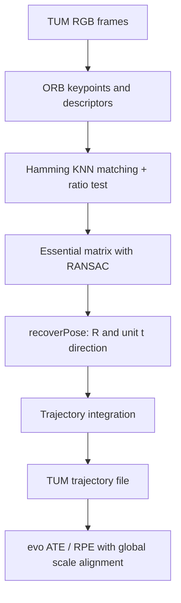

# Visual SLAM & 3D Reconstruction

An educational monocular visual-odometry project built with Python, OpenCV and NumPy. It detects and matches ORB features, estimates two-view geometry with an essential matrix and RANSAC, recovers relative camera motion, and integrates a trajectory on the TUM RGB-D `fr1/xyz` and `fr1/desk` sequences.

**Project timeline:** Started in May 2025. The current public implementation baseline is being published in November 2026. Git commit dates reflect the actual publication and update history; they are not backdated.

The visual-odometry geometry and trajectory integration are implemented in this repository; feature extraction/matching, essential-matrix estimation and pose recovery use OpenCV. Evaluation is intended to use `evo`. Monocular translation is recovered only up to an unknown scale: the estimator does **not** consume ground-truth poses or use ground-truth scale. For evaluation, `evo` performs a single global Sim(3) scale alignment, which must be disclosed alongside metrics.

## Pipeline



## Status

- [x] Monocular ORB visual odometry and TUM-format trajectory export.
- [x] Synthetic unit tests for descriptor matching, essential-matrix pose recovery and trajectory accumulation.
- [ ] TUM dataset runs and measured results: **Not run yet** in the publication environment.
- [ ] `evo` ATE/RPE metrics and plots: **Not run yet**.
- [ ] RGB-D depth-based scale upgrade: **Not implemented**.
- [ ] COLMAP / Gaussian splatting: **Not implemented**.

## Quick start

Python 3.10–3.12 is supported by the pinned project dependencies.

```bash
python -m venv .venv
source .venv/bin/activate  # Windows: .venv\\Scripts\\activate
python -m pip install -e '.[dev]'
bash scripts/download_data.sh
python scripts/run_vo.py --seq fr1_xyz
python scripts/evaluate.py --seq fr1_xyz
```

To run the second sequence, use `--seq fr1_desk` for both commands. Dataset files are downloaded directly from the TUM RGB-D benchmark and are not committed.

## Evaluation and scale

The monocular estimator returns unit translation directions. Absolute translation scale is fundamentally unobservable from a monocular image pair. The benchmark protocol uses a **single global Sim(3) scale alignment during evaluation** with `evo`; no ground-truth scale is injected into the VO pipeline. This makes the reported ATE/RPE scale-aligned evaluation results, not metric-scale odometry. Metrics and plots will only be added after the scripts have actually run successfully.

## Limitations

- Monocular scale ambiguity and accumulated scale drift.
- No loop closure, global bundle adjustment, local mapping or relocalisation.
- No robust keyframe selection or motion-model initialisation yet.
- ORB matching and two-view geometry can fail under low texture, motion blur, dynamic objects and weak parallax.
- This is an educational baseline, not a real-time or production SLAM system.

## Next steps

1. Run both TUM sequences and inspect tracking failures.
2. Add depth-assisted scale estimation from TUM depth frames and compare against the monocular baseline.
3. Add keyframes, local bundle adjustment and loop closure.
4. Compare against ORB-SLAM3 or DROID-SLAM under matching evaluation protocols.
5. Consider COLMAP and Gaussian splatting only after checking available GPU resources.

## License

MIT. Dataset terms remain those of the TUM RGB-D benchmark.
