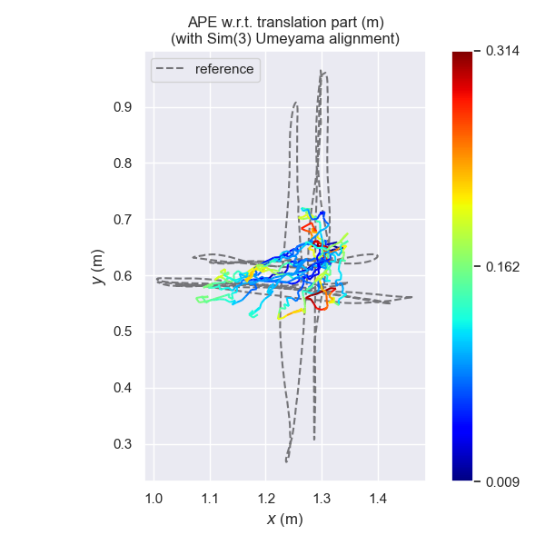
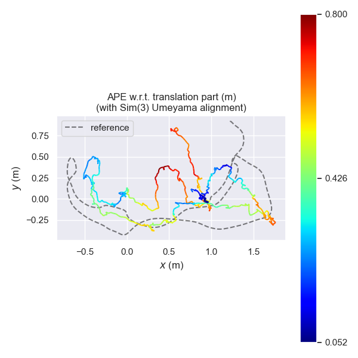

# Visual odometry evaluation

Summary of every benchmark run so far. Each completed row was produced by `scripts/run_vo.py` followed by `scripts/evaluate.py` on the named sequence; the raw evo output is in the linked logs. The per-dataset tables written by the evaluator are [metrics_tum.md](metrics_tum.md) and, once run, `metrics_kitti.md`.

| Dataset / sequence | Frames | ATE RMSE (m) | RPE RMSE (m) | Status |
|---|---:|---:|---:|---|
| KITTI 00 | — | — | — | Not run yet — KITTI grayscale stereo sequence and ground-truth pose archive not downloaded |
| KITTI 01 | — | — | — | Not run yet — KITTI grayscale stereo sequence and ground-truth pose archive not downloaded |
| KITTI 02 | — | — | — | Not run yet — KITTI grayscale stereo sequence and ground-truth pose archive not downloaded |
| TUM fr1_xyz | 798 | 0.148 | 0.0113 | Completed 2026-11-10 ([ATE log](fr1_xyz_ate.log), [RPE log](fr1_xyz_rpe.log)) |
| TUM fr1_desk | 613 | 0.466 | 0.0315 | Completed 2026-11-10 ([ATE log](fr1_desk_ate.log), [RPE log](fr1_desk_rpe.log)) |

## How to read the TUM numbers

The TUM fallback is **monocular** frame-to-frame VO: an essential matrix per consecutive frame pair, unit-length translation per step, no keyframes, no bundle adjustment and no loop closure. evo applies one global Sim(3) alignment (`--align --correct_scale`) before computing errors, because monocular scale is unobservable. RPE uses consecutive frame pairs (`--delta 1 --delta_unit f`).

These are **baseline** numbers and they are weak:

- **fr1_xyz** — the camera translates along x, y and z in a cross pattern of roughly 0.7 m. The estimate collapses into a small cluster near the centre and does not reproduce that shape (see the plot below). Assuming the same step length every frame means slow and fast motion are integrated alike, so the global Sim(3) fit shrinks the whole trajectory.
- **fr1_desk** — the estimate follows the general sweep of the reference for part of the sequence, then drifts; the maximum position error is 0.80 m.

For comparison, published keyframe-based monocular systems with bundle adjustment report ATE on these sequences in the order of centimetres, so this baseline is not competitive. The useful result is the end-to-end pipeline (data loading → pose estimation → TUM export → evo evaluation), not the accuracy.

| fr1_xyz (ATE) | fr1_desk (ATE) |
|---|---|
|  |  |

## Reproduce

    bash scripts/download_data.sh
    python scripts/run_vo.py --dataset tum --seq fr1_xyz
    python scripts/run_vo.py --dataset tum --seq fr1_desk
    python scripts/evaluate.py --dataset tum --seq all

Measured on a laptop CPU (Intel Core i5-8250U): 162 s for fr1_xyz and 115 s for fr1_desk, Python 3.12, evo 1.30.0.

## KITTI (primary benchmark) — still pending

    python scripts/run_vo.py --dataset kitti --seq 00 --data-root data/kitti
    python scripts/evaluate.py --dataset kitti --seq 00 --data-root data/kitti

KITTI evaluation does not apply scale correction, because stereo depth gives metric scale.
